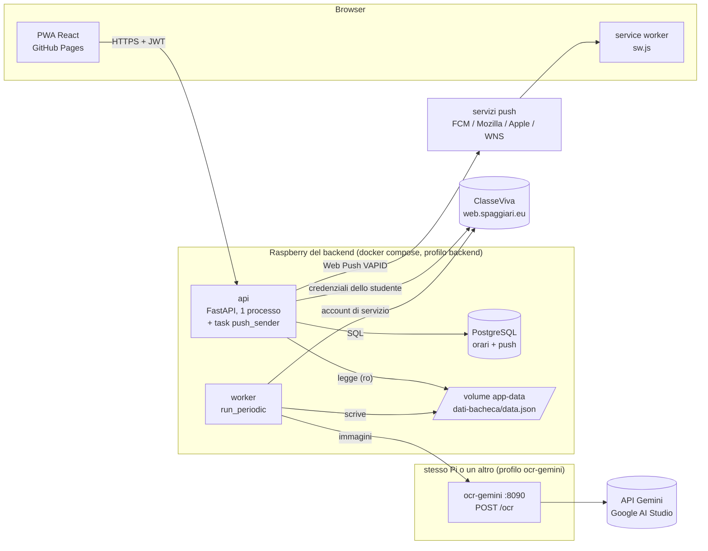
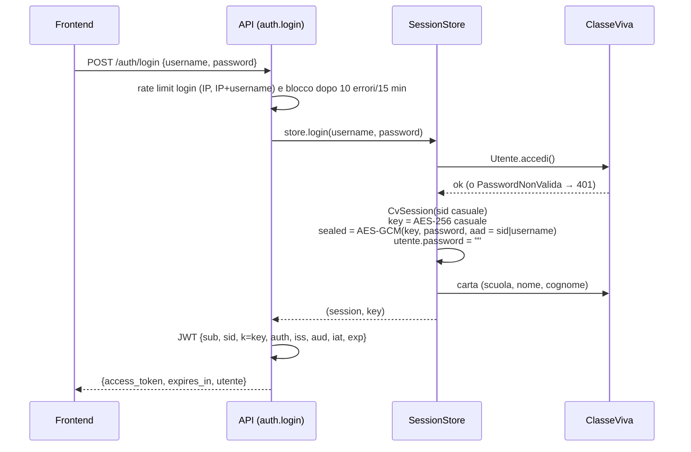
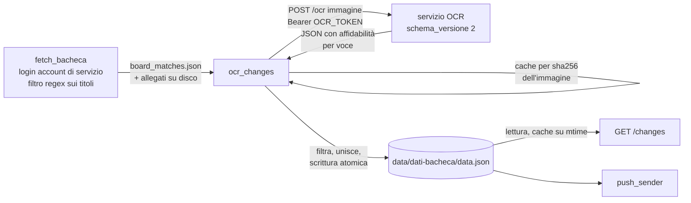

# Skedoo backend: come funziona e perché è fatto così

Questo documento descrive il backend nel suo insieme: i componenti, il percorso di una richiesta, l'integrazione con
ClasseViva, la pipeline bacheca → OCR → variazioni, le notifiche push, la sicurezza, il deploy. Per ogni parte spiega
anche **le scelte strutturali** fatte e cosa costano. Il riferimento rapido degli endpoint e dei formati di risposta
resta [README.md](README.md); lo schema del database è in [db-schema.md](db-schema.md).

Stato al 25/11/2026 (branch `main`, API `0.3.0`): 169 test, tutti verdi.

---

## Indice

1. [Cosa fa il backend (e cosa no)](#1-cosa-fa-il-backend-e-cosa-no)
2. [Componenti in esecuzione](#2-componenti-in-esecuzione)
3. [Struttura del codice](#3-struttura-del-codice)
4. [Il percorso di una richiesta](#4-il-percorso-di-una-richiesta)
5. [Autenticazione e sessioni](#5-autenticazione-e-sessioni)
6. [Integrazione con ClasseViva](#6-integrazione-con-classeviva)
7. [Download in streaming](#7-download-in-streaming)
8. [Orari delle classi](#8-orari-delle-classi)
9. [Variazioni d'orario: dalla bacheca a `/changes`](#9-variazioni-dorario-dalla-bacheca-a-changes)
10. [Notifiche push](#10-notifiche-push)
11. [Sicurezza: riepilogo per minaccia](#11-sicurezza-riepilogo-per-minaccia)
12. [Configurazione](#12-configurazione)
13. [Deploy](#13-deploy)
14. [Test](#14-test)
15. [Scelte strutturali in sintesi](#15-scelte-strutturali-in-sintesi)
16. [Limiti noti e punti di attenzione](#16-limiti-noti-e-punti-di-attenzione)

---

## 1. Cosa fa il backend (e cosa no)

Il backend è un'API **FastAPI** che serve la PWA React (`frontend/`). Ha tre fonti di dati, molto diverse tra loro:

| Fonte | Dati | Dove vive | Chi la legge |
|---|---|---|---|
| **ClasseViva** (registro elettronico) | voti, agenda, assenze, lezioni, bacheca, didattica, profilo | server Spaggiari | l'API, in tempo reale, **con le credenziali dello studente** |
| **Orari delle classi** | orario settimanale di ogni classe | file JSON (sviluppo) o PostgreSQL (produzione) | l'API |
| **Variazioni giornaliere** | entrate posticipate, uscite anticipate, cambi aula | `data/dati-bacheca/data.json` | scritto dal **worker** (bacheca + OCR), letto dall'API |

In più gestisce le **iscrizioni alle notifiche push** (PostgreSQL) e manda le notifiche quando compaiono variazioni nuove.

Cosa il backend **non** fa, per scelta:

- **non salva dati personali degli studenti**: voti, assenze, agenda passano dall'API senza essere scritti da nessuna
  parte (c'è solo una cache in memoria di 60 secondi per sessione);
- **non ha utenti propri**: l'identità è quella di ClasseViva, il login è il login ClasseViva;
- **non conserva le password**: la tiene in memoria solo cifrata, con una chiave che il server non possiede (§5);
- **non fa OCR**: lo delega a un servizio separato (`helper/OCR/V5-Gemini`), anche su un'altra macchina (§9).

---

## 2. Componenti in esecuzione



| Componente | Comando | Ruolo |
|---|---|---|
| **api** | `uvicorn app.main:app --workers 1` | tutti gli endpoint HTTP; nel suo processo gira anche il task periodico delle notifiche push |
| **worker** | `python -m scripts.bacheca_fetch.run_periodic` | ogni 15 minuti: scarica la bacheca con un account ClasseViva dedicato, manda le immagini dei cartelloni all'OCR, scrive il file delle variazioni |
| **db** | `postgres:16-alpine` | orari delle classi e iscrizioni push; nessun dato degli studenti |
| **ocr-gemini** | `helper/OCR/V5-Gemini/service.py` (in rete anche col nome `ocr`) | legge un'immagine e restituisce un JSON strutturato con un'affidabilità per ogni voce |

`api` e `worker` usano **la stessa immagine Docker** (`backend/Dockerfile`): cambia solo il comando.

> **Scelta: worker separato dall'API.** Il fetch della bacheca e l'OCR sono lenti (una richiesta a Gemini per immagine,
> con ritentativi anche di minuti se il servizio è sovraccarico) e usano credenziali diverse da quelle degli studenti. Tenerli in un processo a parte significa che un OCR
> bloccato o un errore di ClasseViva non toccano l'API, che l'API non ha mai le credenziali del worker, e che l'API può
> montare il volume dei dati **in sola lettura**.

---

## 3. Struttura del codice

```
backend/
  app/
    main.py          FastAPI, lifespan (DB + task push), middleware, CORS, router
    config.py        Settings (pydantic-settings) e controlli per la produzione
    errors.py        AppError e formato errori {"code", "message"}
    validation.py    controlli comuni (intervalli di date)
    security.py      JWT, rate limiter, dipendenze current_session / upstream_limit
    classeviva.py    sessioni ClasseViva: login, password cifrata, lock, cache, ri-login
    db.py            modelli SQLAlchemy e engine

    auth.py          /auth/login, /auth/me, /auth/refresh, /auth/logout
    grades.py        /grades
    agenda.py        /agenda
    absences.py      /assenze
    lessons.py       /lezioni
    board.py         /bacheca (+ dettaglio e download allegati)
    didactics.py     /didattica (+ download materiali)
    downloads.py     streaming dei file da ClasseViva (usato da board e didactics)
    schedules.py     /schedules: orari da JSON o da DB, griglia oraria della scuola
    changes.py       /changes: variazioni lette dal file del worker
    push.py          /push: chiave pubblica, subscribe, unsubscribe
    push_sender.py   task periodico che invia le notifiche

  scripts/
    bacheca_fetch/fetch_bacheca.py   scarica e filtra la bacheca, salva gli allegati
    bacheca_fetch/ocr_changes.py     allegati → OCR → data/dati-bacheca/data.json
    bacheca_fetch/run_periodic.py    ciclo del worker (fetch + OCR ogni N secondi)
    import_schedules.py              JSON degli orari → PostgreSQL
    generate_vapid.py                genera le chiavi VAPID
    send_test_push.py                notifica di prova ai dispositivi di una classe
    healthcheck.py                   healthcheck del container api

  tests/              pytest (ClasseViva finto, SQLite o PostgreSQL vero)
```

### Dipendenze tra i moduli

```
main ──► auth, grades, agenda, absences, lessons, board, didactics, schedules, changes, push, push_sender
           │         (tutti i router)
           ▼
       security ──► classeviva ──► config, errors
           │
board, didactics ──► downloads ──► classeviva
changes ──► schedules (griglia SLOTS)
push ──► changes (validate_class), push_sender (mark_current_as_sent)
push_sender ──► changes (build_changes), db
schedules, push, push_sender ──► db ──► config
```

Ogni modulo di dominio segue lo stesso schema:

1. **modelli Pydantic di risposta** (`GradeOut`, `AgendaOut`, …) con nomi di campo **in italiano** e pensati per il
   frontend, non copiati da ClasseViva;
2. una **funzione pura** `build_*(raw) -> Modello` che trasforma la risposta grezza di ClasseViva;
3. un **endpoint** sottile che valida i parametri, chiama `session.call(...)` e passa il risultato a `build_*`.

> **Scelta: funzioni `build_*` pure.** La traduzione dal formato ClasseViva (campi come `evtCode`, `decimalValue`,
> `periodPos`) al formato dell'app è il punto in cui si concentrano le regole (media pesata, tipi di assenza,
> compresenze…). Tenerla in funzioni senza I/O le rende testabili con dati finti e isola il frontend dai cambi di
> formato di ClasseViva: se un campo cambia nome si tocca una riga, non l'app.

---

## 4. Il percorso di una richiesta

### Middleware

In Starlette l'ultimo middleware aggiunto è il più esterno. In [main.py](../app/main.py) l'ordine risultante è:

```
richiesta ─► CORSMiddleware ─► TrustedHostMiddleware ─► protect() ─► router ─► dipendenze ─► endpoint
```

| Strato | Cosa fa |
|---|---|
| **CORS** | solo le origini di `CORS_ORIGINS`, solo `GET`/`POST`, header `Authorization` e `Content-Type`; espone `Retry-After` e `Content-Disposition`. Essendo il più esterno, anche le risposte 413/429 hanno gli header CORS e il browser può leggerle. |
| **TrustedHost** | rifiuta gli header `Host` non elencati in `ALLOWED_HOSTS` (in produzione `*` è vietato). |
| **protect()** | rate limit per IP (300/min), rifiuto dei body > 16 KB e di qualsiasi `Transfer-Encoding` (il body deve dichiarare la lunghezza), header di sicurezza (`nosniff`, `X-Frame-Options: DENY`, `Referrer-Policy: no-referrer`, `Cache-Control: no-store`; in produzione anche HSTS e una CSP `default-src 'none'`). |

### Dipendenze

Gli endpoint non controllano il token da soli: lo fanno le dipendenze FastAPI dichiarate **sul router**, così un
endpoint nuovo è protetto per costruzione.

- `current_session` ([security.py](../app/security.py)): legge il Bearer, verifica il JWT, trova la sessione in memoria,
  applica il limite per utente (60/min) e restituisce un `ActiveSession`. È su **tutti** i router tranne il login.
  `test_only_login_and_health_are_open` scorre tutte le route e fallisce se ce n'è una aperta in più.
- `upstream_limit`: limite in più (20/min per utente) per i router che chiamano ClasseViva (voti, agenda, assenze,
  lezioni, bacheca, didattica). Dipende da `current_session`; FastAPI la risolve una sola volta per richiesta, quindi il
  limite per utente non viene contato due volte.
- `require_push`: sul router `/push`, risponde 503 `push_disabled` se le notifiche non sono configurate.

### Errori

Tutti gli errori hanno la forma `{"code": "...", "message": "..."}` ([errors.py](../app/errors.py)). Il `code` è
stabile e il frontend decide in base a quello (es. `session_expired` → schermata di login); il `message` è in italiano
e mostrabile.

- `AppError(status, code, message)` è l'unica eccezione "voluta" che il codice solleva.
- Gli errori di validazione (422) **non ripetono l'input** (FastAPI di default restituisce `input`, che nel login
  sarebbe la password).
- Errori SQLAlchemy → 503 `database_unavailable`; qualsiasi altra eccezione → 500 `internal_error`. Il dettaglio va
  solo nei log, mai al client.
- Le eccezioni di Classeviva.py sono tradotte da `translate()` in [classeviva.py](../app/classeviva.py): password
  errata → 401, formato/parametro → 422, data fuori anno → 422, tutto il resto → 502 `classeviva_error`.

---

## 5. Autenticazione e sessioni

Questa è la parte più delicata del backend: per leggere i dati di ClasseViva serve la password dello studente, e
ClasseViva fa scadere la propria sessione circa ogni ora e mezza. Il server deve quindi poter **rifare il login da
solo**, senza però conservare password in chiaro.

### Login



Dopo il login:

- **sul server** resta una `CvSession` in memoria con la password **cifrata** (`_sealed`), l'oggetto `Utente` di
  Classeviva.py (con la password svuotata), una cache e un lock;
- **nel JWT** c'è la chiave `k` che decifra quella password. Il server non la conserva: la riceve con ogni richiesta.

### Una richiesta autenticata

1. `current_session` decodifica il JWT: algoritmo fissato a HS256 (niente `alg: none`), `iss`/`aud` = `skedoo`,
   claim obbligatori, `k` deve essere esattamente 32 byte.
2. `store.get(sid, username)` trova la sessione; se non c'è (logout, riavvio) → 401 `session_expired`.
3. Viene creato un `ActiveSession`: un oggetto che vive **solo per la durata della richiesta** e unisce la sessione
   condivisa alla chiave arrivata col token.
4. `session.call("voti", "26")` → nel thread, sotto il lock della sessione, la password viene decifrata e messa
   in `Utente` solo per la durata della chiamata (serve se ClasseViva chiede un nuovo login), poi tolta.

> **Scelta: password cifrata con chiave lato client.** Le alternative erano (a) tenere la password in chiaro in
> memoria, (b) non tenerla e far rifare il login all'utente ogni ora e mezza, (c) salvarla sul dispositivo. Con la
> chiave nel JWT servono **due** cose per ricavare una password: la memoria del server e il token di quello studente.
> Un dump della memoria trova solo testi cifrati; un token rubato, da solo, non contiene la password. L'AAD
> `sid|username` impedisce di spostare un testo cifrato su un'altra sessione. Il costo: il JWT è firmato ma non
> cifrato, quindi `k` è leggibile da chi ha il token (va trattato come un segreto, come qualsiasi bearer token).

### Durata, rinnovo, logout

| Evento | Comportamento |
|---|---|
| Durata di un token | `JWT_TTL_HOURS` (168 = 7 giorni) |
| `POST /auth/refresh` | nuovo token per **la stessa sessione** (stessi `sid` e `k`), senza password. Il frontend lo chiama quando il token ha più di 12 ore. |
| Limite assoluto | `exp` non supera mai `auth + SESSION_MAX_DAYS` (90 giorni): `auth` è l'istante del login e resta uguale a ogni rinnovo |
| `POST /auth/logout` | chiude **solo la sessione di quel dispositivo** |
| Pulizia | a ogni login vengono eliminate le sessioni inattive da più di `JWT_TTL_HOURS`. Ogni richiesta, anche senza chiamate a ClasseViva (orari, `/auth/me`), aggiorna `last_used`. |
| Riavvio del server | tutte le sessioni spariscono → 401 `session_expired` → il frontend riporta al login, con username e nome già compilati (sul dispositivo non c'è mai la password) |
| Password cambiata su ClasseViva | al primo ri-login fallito la sessione viene chiusa → 401 `credentials_changed` |

Studente e genitore con lo stesso browser sono due sessioni distinte (il frontend tiene due JWT e passa dall'uno
all'altro). Il `tipo` (`studente`/`genitore`) viene dal prefisso del codice ClasseViva (`S…`/`G…`).

### Protezione del login

Il login è l'unico endpoint senza JWT, quindi ha limiti propri in [auth.py](../app/auth.py):

- 5 tentativi/minuto per coppia (IP, username), 30/minuto per IP;
- dopo 10 password sbagliate in 15 minuti per (IP, username) il login è bloccato **anche con la password giusta**
  (non si può usare l'API come oracolo per indovinarla); un login riuscito azzera il contatore;
- `username` max 64 caratteri senza spazi né caratteri di controllo, `password` max 256: sono input non fidati che
  finiscono nei log e nelle richieste a ClasseViva.

### Rate limiter

`RateLimiter` è una finestra scorrevole in memoria (una `deque` di istanti per chiave, protetta da un lock). Quando le
chiavi superano 20.000 elimina quelle ferme da più di un'ora. Chiavi usate:

| Chiave | Limite | Dove |
|---|---|---|
| `ip:<ip>` | 300/min | ogni richiesta (largo: a scuola tanti studenti escono dallo stesso IP) |
| `user:<username>` | 60/min | ogni endpoint protetto |
| `upstream:<username>` | 20/min | endpoint che chiamano ClasseViva |
| `login-ip:<ip>`, `login:<ip>\|<user>` | 30 e 5/min | login |
| `fail:<ip>\|<user>` | 10 in 15 min | password sbagliate |

L'IP del client viene da `X-Forwarded-For` **solo** con `TRUST_PROXY_HEADERS=true`, e in quel caso si prende
**l'ultima** voce (quella aggiunta dal proxy fidato; le precedenti le può scrivere chiunque). Per questo uvicorn gira
con `--no-proxy-headers`: la logica è una sola e sta nell'app.

---

## 6. Integrazione con ClasseViva

### Il problema di Classeviva.py

La libreria [Classeviva.py](https://pypi.org/project/Classeviva.py/) espone metodi `async`, ma dentro usa `requests`,
che è sincrono: chiamati direttamente dall'event loop di FastAPI lo bloccherebbero per tutta la durata della richiesta
HTTP a ClasseViva, e con lui tutti gli altri utenti.

La soluzione in [classeviva.py](../app/classeviva.py):

```
async CvSession.call(method, *args)
  └─ asyncio.to_thread(_run)            # in un thread del pool
       └─ with self._lock:              # una chiamata alla volta per sessione
            password decifrata in Utente
            asyncio.run(utente.<method>(*args))   # event loop privato del thread
            password tolta
```

- **un lock per sessione**: la `requests.Session` interna di `Utente` non è fatta per l'uso concorrente; utenti diversi
  invece vanno in parallelo;
- **cache per sessione** di `CACHE_TTL_SECONDS` (60 s) per `(metodo, argomenti)`: il frontend chiede spesso le stesse
  cose (es. voti in home e nella pagina voti), e ClasseViva è lento e ha limiti propri. A ogni scrittura si eliminano
  le voci scadute, perché una sessione può vivere giorni;
- **un solo nuovo tentativo**: se ClasseViva risponde con un errore HTTP (non 404), si azzera `utente.inizio` (che fa
  rifare il login a Classeviva.py) e si riprova una volta. È il caso tipico della sessione ClasseViva scaduta.

### Cosa fa ogni endpoint

| Endpoint | Metodo `Utente` | Trasformazioni principali |
|---|---|---|
| `GET /grades` | `voti(anno)` + `materie()` | raggruppa per materia; **media pesata** per `weightFactor` escludendo annullati, `noAverage`, giudizi non numerici e pesi ≤ 0; `media_generale` = media semplice delle medie di materia; `voto` (testo da mostrare, es. "7+") separato da `valore` (numero per i calcoli); `periodo_pos` per filtrare i quadrimestri lato client con una sola richiesta; anno di default calcolato con il cambio a settembre. I docenti (`materie`) sono un "di più": se la chiamata fallisce i voti arrivano lo stesso. |
| `GET /agenda` | `agenda_da_a(da, a)` | default oggi…+13 giorni, max 366; raggruppa per giorno; `AGHW` → compito, `AGNT` → annotazione, altro → evento; ore lette dalla stringa così come la scrive la scuola (niente conversioni di fuso) |
| `GET /assenze` | `assenze()` o `assenze_da_a()` | `ABA0` assenza, `ABR0`/`ABR1` ritardo, `ABU0` uscita; riepilogo con conteggi e "da giustificare" |
| `GET /lezioni` | `lezioni_giorno(data)` | compresenze (`LSC0`, `LSS0`) marcate e ordinate dopo la lezione della stessa ora; argomento ripulito da spazi e righe vuote, tagliato a 5000 caratteri |
| `GET /bacheca` | `bacheca()` | elenco con allegati |
| `GET /bacheca/{codice}/{id}` | `bacheca_leggi()` | solo `titolo` e `testo` (il resto della risposta di ClasseViva non viene esposto). **Effetto collaterale**: segna la comunicazione come letta su ClasseViva. |
| `GET /didattica` | `didattica()` | docenti → cartelle → materiali |
| `POST /auth/login`, `GET /auth/me` | `accedi()`, `carta()` | profilo e scuola; la scuola viene caricata una volta al login e tenuta nella sessione, non nel JWT |

> **Scelta: nessun dato di ClasseViva salvato.** Il backend è un proxy che normalizza. Non c'è sincronizzazione, non
> c'è un database di voti: i dati sono sempre quelli di ClasseViva (al massimo vecchi di 60 secondi) e un furto del
> database non espone niente degli studenti. Il prezzo è la latenza: ogni pagina dipende dalla velocità di ClasseViva.

---

## 7. Download in streaming

Allegati della bacheca e materiali della didattica passano da [downloads.py](../app/downloads.py) invece che da
Classeviva.py, perché la libreria legge `response.content`, cioè **tutto il file in RAM**: su un Raspberry un file da
250 MB moltiplicato per qualche utente basta a far chiudere il container.

Come funziona `stream_file`:

1. prende uno **slot** per l'utente (max `MAX_PARALLEL_DOWNLOADS` = 2 contemporanei, altrimenti 429);
2. `session.connection()` fa il login su ClasseViva se serve e restituisce id studente, header e **una copia** dei
   cookie; il lock della sessione si rilascia subito, così un download lungo non blocca le altre chiamate dell'utente;
3. apre la richiesta in streaming con una `requests.Session` propria; i redirect si seguono a mano (max 3) **solo in
   https verso `*.spaggiari.eu`** (la CDN dei documenti);
4. 401/403 da ClasseViva → nuovo login e un solo altro tentativo; 404 → `file_not_found`;
5. se la risposta è JSON (succede per i materiali che sono link o testo) la legge fino a 256 KB e la trasforma in
   `{tipo: "link", url}` o `{tipo: "testo", testo}`;
6. se ClasseViva dichiara una dimensione oltre `MAX_DOWNLOAD_MB` → 413 prima di iniziare;
7. inoltra il file a pezzi da 64 KB; ogni pezzo rinnova lo slot. Se la dimensione non era dichiarata e si supera il
   limite, il generatore **solleva un'eccezione** invece di terminare: la connessione si chiude senza chiudere la
   risposta, e il client vede un download fallito invece di un file troncato che sembra completo.

Il nome del file arriva dal `Content-Disposition` di ClasseViva, ripulito da percorsi e caratteri di controllo e
rimandato sia in ASCII sia in `filename*=UTF-8''…`. Uno slot fermo da più di 120 s (client sparito prima dell'inizio)
viene considerato perso.

---

## 8. Orari delle classi

### Due sorgenti, stessa interfaccia

[schedules.py](../app/schedules.py) ha due implementazioni con gli stessi metodi `list()` e `get(class_id)`:

| `SCHEDULE_SOURCE` | Classe | Uso |
|---|---|---|
| `json` (default) | `JsonStore` | sviluppo: legge `data/classi_index.json`, `data/tutte_le_classi.json`, `data/classi/*.json` (in quest'ordine, l'ultimo vince) una volta all'avvio |
| `db` | `DbStore` | produzione (obbligatorio con `ENVIRONMENT=production`): PostgreSQL, una query per richiesta |

Entrambe producono gli stessi `ClassOut` passando per `make_lesson` e `make_class`, e un test
(`test_db_gives_same_data_as_json`) verifica che le risposte siano identiche.

> **Scelta: JSON in sviluppo, DB in produzione.** I JSON sono l'output della pipeline che estrae gli orari dal PDF della
> scuola (`helper/orario_dataset`): in sviluppo basta copiarli in `data/` senza installare PostgreSQL. In produzione il
> database dà transazioni (un import fallito non lascia orari a metà) e vincoli (una sola lezione per slot). Lo script
> [import_schedules.py](../scripts/import_schedules.py) riusa lo stesso `load_json` dell'API, quindi i due mondi non
> possono divergere nel parsing.

### Griglia oraria

L'ora di fine e il numero d'ora **non sono salvati**: si calcolano dall'inizio della lezione e dalla griglia `SLOTS`
(11 ore da 50 minuti a partire dalle 08:10, pause 10:40–10:55 e 16:10–16:20). Una lezione che non inizia su uno slot
ha `ora = null` e dura 50 minuti. Gli inizi della griglia precedente senza pause (`10:40`, `16:10`), ancora presenti
in alcuni JSON e nel DB, vengono letti come `10:55` e `16:20` (`LEGACY_STARTS`).

La stessa griglia è usata da `changes.py` per capire quali ore tocca una variazione.

### Import nel database

`python -m scripts.import_schedules` è **idempotente** e gira in una sola transazione:

- per ogni classe nei file, aggiorna i dati della classe e **sostituisce** tutte le sue lezioni;
- una classe senza orario (presente solo nell'indice) aggiorna nome e coordinatore ma non cancella le lezioni;
- le classi che non compaiono nei file non vengono toccate.

Durante il parsing vengono scartate le righe senza materia (rumore dell'estrazione dal PDF) e i docenti duplicati.

### Endpoint

`/schedules/classes`, `/schedules/{classe}`, `/schedules/{classe}/today` (fuso `Europe/Rome`; nei giorni senza lezione
`attivo: false`). L'id della classe accetta solo `[A-Za-z0-9 ]{1,16}` e non distingue maiuscole e spazi (`5 j` = `5J`).

---

## 9. Variazioni d'orario: dalla bacheca a `/changes`

Le variazioni giornaliere (entrate posticipate, uscite anticipate, niente lezioni pomeridiane, cambi aula) la scuola le
pubblica come **immagini di un cartellone** allegate a una comunicazione in bacheca ("Comunicazioni per lunedì 17…").
Non esiste un'API: bisogna leggere le immagini.



### Fase 1: fetch ([fetch_bacheca.py](../scripts/bacheca_fetch/fetch_bacheca.py))

- login con `CLASSVIVA_USERNAME`/`CLASSVIVA_PASSWORD` (un account dedicato, non quello degli studenti);
- tiene le comunicazioni il cui testo (tutti i campi, anche annidati) corrisponde alla regex
  `comunicazioni per/del/di … <giorno>` o `aggiornamento comunicazione …`, senza distinguere maiuscole;
- scarica gli allegati **solo se non sono già sul disco** (il fetch gira ogni 15 minuti); prova sia `cntId` sia `pubId`
  perché versioni diverse di ClasseViva usano identificativi diversi; una comunicazione che fallisce non blocca le altre;
- scrive `board_matches.json` in modo atomico (file `.tmp` + `replace`). Le credenziali non finiscono mai nei messaggi
  d'errore.

### Fase 2: OCR ([ocr_changes.py](../scripts/bacheca_fetch/ocr_changes.py))

Due modi di eseguire l'OCR, con lo stesso risultato:

| Modo | Quando | Come |
|---|---|---|
| **HTTP** | `OCR_URL` impostato (deploy) | `POST <OCR_URL>/ocr?nome=…` con il corpo dell'immagine e `Authorization: Bearer <OCR_TOKEN>` (≥ 32 caratteri). Avviso nei log se l'URL è un IP pubblico in chiaro. |
| **processo locale** | `OCR_URL` vuoto (sviluppo) | `python helper/OCR/V5-Gemini/main.py <immagine> --out <tmp>` con `OCR_PYTHON`; `GEMINI_API_KEY` e `GEMINI_MODELS` di `.env` vengono passate al processo |

L'OCR è `helper/OCR/V5-Gemini`: segmentazione OpenCV sul Pi, ritagli letti dall'API Gemini, JSON con
`schema_versione: 2`. Segmentazione, parser e validatori vengono dalla V4 (Qwen3-VL su Ollama, archiviata in
`history/OCR/V4-AI`) e sono copiati nella cartella della V5 (`orario/`), che non dipende da altro. Nel compose il
container ha l'alias di rete `ocr`: passare dalla V4 alla V5 non ha richiesto modifiche al worker.

Il modello **trascrive soltanto**; il codice della pipeline OCR controlla ogni voce (formato,
griglia oraria, elenchi di classi e aule, colori, coerenza tra voci) e le assegna un'affidabilità `alta`, `media` o
`bassa`.

Poi `ocr_changes`:

1. **cache per contenuto**: il risultato di ogni immagine si salva come `data/bacheca_fetch/ocr/<sha256>.json`;
   un'immagine già letta non viene più mandata all'OCR (importante con la quota gratuita di Gemini). Un risultato con `schema_versione` diversa da 2 viene rifiutato;
2. **affidabilità minima**: tiene solo le voci con affidabilità ≥ `BACHECA_OCR_MIN_AFFIDABILITA` (default `alta`) e
   solo i campi utili al backend;
3. **data del cartellone**: valida se il titolo è abbastanza affidabile *oppure* se la data cade tra 3 giorni prima e
   10 giorni dopo la pubblicazione della comunicazione; altrimenti l'immagine viene ignorata (una data sbagliata
   sposterebbe tutte le variazioni su un altro giorno);
4. **una data, una comunicazione**: se più comunicazioni riguardano la stessa data vale la più recente
   ("Aggiornamento comunicazione…" sostituisce la precedente); le immagini della stessa comunicazione si uniscono;
5. scarta i giorni passati e scrive `data/dati-bacheca/data.json` in modo atomico;
6. **se nessuna immagine è stata letta** (OCR giù) il file precedente resta com'è invece di essere svuotato.

> **Scelta: un file come interfaccia tra worker e API.** Il worker scrive un JSON, l'API lo legge. Non serve una coda né
> una tabella: il formato è leggibile a mano, l'API lo monta in sola lettura e non ha bisogno di credenziali verso
> l'OCR o ClasseViva. La scrittura atomica garantisce che l'API non legga mai un file a metà. Il limite: funziona solo
> se worker e API condividono un disco (stesso host, stesso volume).

> **Scelta: preferire l'omissione all'errore.** Con soglia `alta`, una variazione dubbia non compare. È preferibile che
> uno studente non veda un cambio aula piuttosto che vada nell'aula sbagliata per un errore di lettura. La soglia è
> configurabile.

### Fase 3: lettura nell'API ([changes.py](../app/changes.py))

- il file viene letto con `lru_cache` su `(percorso, mtime_ns)`: quando il worker lo riscrive la cache si rinnova da
  sola, senza riavviare l'API; file mancante o illeggibile → 503 `changes_unavailable`;
- è accettato anche il vecchio formato a giorno singolo;
- **classi articolate**: `3C/T` sul cartellone vale per `3C`, `3T` e `3C/T`. Nei cambi aula le righe successive del
  pannello non riportano la classe: l'OCR la deduce (`classe_dedotta`);
- **ore coinvolte**, calcolate dalla griglia di `schedules.py`:

| Tipo | `ora` | `ore` | Esempio |
|---|---|---|---|
| `entrata_posticipata` | prima ora seguita | ore saltate; se l'entrata è nel pomeriggio solo le ore pomeridiane precedenti | 09:50 → ora 3, ore [1, 2]; 15:20 → ore [8] |
| `uscita_anticipata` | prima ora persa | uscendo al mattino solo le ore del mattino rimaste (il pomeriggio resta); uscendo al pomeriggio il resto della giornata | 11:45 → ore [5, 6, 7] |
| `senza_lezioni_pomeridiane` | 8 | dall'8ª all'ultima | |
| `cambio_aula` | prima ora | ore in cui vale | "09:50 - 11:45" → [3, 4] |

- l'`id` di ogni variazione è stabile (`aula-2026-11-17-<unit_id>`), quindi il frontend e le notifiche possono
  riconoscerla tra una lettura e l'altra.

Endpoint: `/changes`, `/changes/entrate-uscite`, `/changes/cambi-aula`, tutti con `?classe=` obbligatorio e `?data=`
facoltativo. Richiedono il login ma non chiamano ClasseViva (niente `upstream_limit`).

### Il ciclo del worker ([run_periodic.py](../scripts/bacheca_fetch/run_periodic.py))

Esegue un giro all'avvio (disattivabile con `BACHECA_FETCH_RUN_ON_START=false`), poi uno ogni
`BACHECA_FETCH_INTERVAL_SECONDS` (900). L'OCR parte solo se il fetch è andato a buon fine e gira in un thread, così
SIGTERM ferma il processo anche durante una lettura lunga. Un'eccezione inattesa viene registrata e il giro successivo
riparte: un processo periodico non deve morire per un errore singolo.

---

## 10. Notifiche push

Web Push standard con chiavi **VAPID**, senza servizi terzi oltre ai servizi push dei browser. Attive solo se ci sono
`VAPID_PUBLIC_KEY`, `VAPID_PRIVATE_KEY` e `DATABASE_URL`; altrimenti `/push/*` risponde 503 e il task non parte.

### Iscrizione ([push.py](../app/push.py))

1. il frontend chiede `GET /push/public-key` e crea l'iscrizione nel browser (`PushManager.subscribe`);
2. `POST /push/subscribe {subscription, classe}` salva endpoint, chiavi del browser e classe. Con lo stesso `endpoint`
   aggiorna la riga (es. cambio di classe) invece di crearne un'altra; due richieste contemporanee si risolvono con un
   secondo tentativo dopo l'`IntegrityError`;
3. se il dispositivo è **il primo della sua classe**, tutte le variazioni già pubblicate vengono segnate come inviate:
   quelle le vede già nell'app, si notificano solo le prossime;
4. `POST /push/unsubscribe {endpoint}` cancella l'iscrizione (notifiche spente o logout), senza errori se non esiste.

L'`endpoint` è accettato solo se è `https` sulla porta 443 verso un servizio push noto (`fcm.googleapis.com`,
`push.services.mozilla.com`, `notify.windows.com`, `push.apple.com`, …). Il server fa una POST a quell'indirizzo:
un URL libero permetterebbe a chiunque abbia un account di far chiamare all'API servizi interni (**SSRF**).

> **Scelta: l'iscrizione è un dispositivo, non uno studente.** La tabella `push_subscriptions` non ha username: l'unico
> legame è la classe. Per mandare "variazioni della 4A" non serve sapere chi è iscritto, e un furto del database non
> rivela chi usa l'app. Le tabelle push non hanno chiavi esterne verso `classes`, così funzionano anche con gli orari
> da JSON.

### Invio ([push_sender.py](../app/push_sender.py))

Un task asyncio avviato nel `lifespan` dell'API esegue `run_once` in un thread ogni `PUSH_CHECK_SECONDS` (60):

1. se è nelle ore di silenzio (`PUSH_QUIET_START`–`PUSH_QUIET_END`, default 22:00–06:30, anche a cavallo della
   mezzanotte) non fa niente: le novità partono alla fine del silenzio;
2. cancella da `push_sent` le righe dei giorni passati;
3. per ogni classe con iscritti e per ogni giorno da oggi in poi: se c'è almeno una variazione non ancora notificata,
   manda **una notifica con tutte le variazioni del giorno**. Il `tag` (`variazioni-4A-2026-11-26`) fa sì che sul
   telefono la nuova sostituisca la precedente: resta sempre l'elenco aggiornato;
4. segna le variazioni in `push_sent` e fa commit classe per classe (un errore a metà non fa rimandare quelle già
   notificate).

Dettagli:

- `change_key` = sha256 di id **e contenuto**: se l'OCR corregge una variazione (altra aula, altro orario) la si
  notifica di nuovo; un file semplicemente riscritto con gli stessi dati non fa ripartire niente, nemmeno dopo un
  riavvio;
- invio in parallelo (8 thread), TTL 12 ore (un telefono spento che si riaccende dopo non riceve notizie vecchie),
  `Urgency: high`;
- iscrizioni a cui il servizio risponde 404/410 (scadute o revocate) vengono cancellate; gli altri errori sono solo
  registrati, e un dispositivo che fallisce non blocca gli altri;
- il payload `{title, body, tag, url}` è letto da `frontend/public/sw.js`.

---

## 11. Sicurezza: riepilogo per minaccia

| Minaccia | Contromisura | Dove |
|---|---|---|
| Furto della memoria del server | password solo cifrate (AES-256-GCM), chiave non sul server | `classeviva.py` |
| Furto di un token | il token non contiene la password; vale solo finché la sessione è viva; logout per dispositivo | `security.py`, `auth.py` |
| Token contraffatti | HS256 fisso, `iss`/`aud`, claim obbligatori, `JWT_SECRET` ≥ 32 caratteri obbligatorio in produzione | `security.py`, `config.py` |
| Brute force sul login | limiti per IP e per (IP, username), blocco dopo 10 errori anche con password giusta | `auth.py` |
| Abuso dell'API / di ClasseViva tramite l'API | limiti per IP, utente e chiamate a ClasseViva; cache | `security.py`, `classeviva.py` |
| IP falsificato per aggirare i limiti | `X-Forwarded-For` ignorato se non dietro proxy fidato; ultima voce soltanto | `security.py` |
| Body enormi / esaurimento memoria | body max 16 KB (64 KB su Caddy), download in streaming con limite di dimensione e di concorrenza | `main.py`, `downloads.py` |
| SSRF | push solo verso servizi noti; redirect dei download solo verso `*.spaggiari.eu` in https | `push.py`, `downloads.py` |
| Fuga di dettagli negli errori | errori con codice stabile, nessun input ripetuto, dettagli solo nei log | `errors.py` |
| Cache di dati personali | `Cache-Control: no-store` su tutto | `main.py` |
| Header Host / CORS arbitrari | `ALLOWED_HOSTS` e `CORS_ORIGINS` espliciti obbligatori in produzione | `config.py` |
| Clickjacking, sniffing, referrer | `X-Frame-Options: DENY`, `nosniff`, `no-referrer`, CSP `default-src 'none'`, HSTS | `main.py` |
| Nomi di file malevoli | nome ripulito da percorsi e caratteri di controllo | `downloads.py`, `fetch_bacheca.py` |
| Accesso al servizio OCR | token condiviso confrontato in tempo costante (`hmac.compare_digest`) | `helper/OCR/*/service.py` |
| Compromissione di un container | utente senza privilegi, filesystem in sola lettura, nessuna capability, `no-new-privileges`, DB su rete interna senza internet, porta API solo su 127.0.0.1 | `Dockerfile`, `compose.yaml` |
| Documentazione come mappa per un attaccante | `/docs` e `/openapi.json` spenti in produzione | `main.py` |

---

## 12. Configurazione

Tutte le impostazioni sono in `Settings` ([config.py](../app/config.py)), lette da variabili d'ambiente o da
`backend/.env` (pydantic-settings). `get_settings()` è in `lru_cache`: un'istanza per processo.

| Gruppo | Variabili principali | Default |
|---|---|---|
| Ambiente | `ENVIRONMENT` | `development` |
| JWT | `JWT_SECRET`, `JWT_TTL_HOURS`, `SESSION_MAX_DAYS` | casuale a ogni avvio, 168, 90 |
| Rete | `CORS_ORIGINS`, `ALLOWED_HOSTS`, `TRUST_PROXY_HEADERS` | localhost:5173/3000, `*`, false |
| Rate limit | `RATE_LIMIT_IP`, `RATE_LIMIT_USER`, `RATE_LIMIT_UPSTREAM`, `LOGIN_ATTEMPTS`, `LOGIN_FAILURES` | 300, 60, 20, 5, 10 |
| Orari | `SCHEDULE_SOURCE`, `DATA_DIR`, `DATABASE_URL` | `json`, `backend/data`, — |
| Download | `MAX_DOWNLOAD_MB`, `MAX_PARALLEL_DOWNLOADS` | 250, 2 |
| Varie | `CACHE_TTL_SECONDS`, `TIMEZONE` | 60, `Europe/Rome` |
| Push | `VAPID_PUBLIC_KEY`, `VAPID_PRIVATE_KEY`, `VAPID_SUBJECT`, `PUSH_CHECK_SECONDS`, `PUSH_QUIET_START`, `PUSH_QUIET_END` | spente, 60, 22:00, 06:30 |
| Worker | `CLASSVIVA_USERNAME`, `CLASSVIVA_PASSWORD`, `BACHECA_FETCH_INTERVAL_SECONDS`, `BACHECA_OCR_ENABLED`, `BACHECA_OCR_MIN_AFFIDABILITA`, `OCR_URL`, `OCR_TOKEN`, `OCR_TIMEOUT_SECONDS` | —, —, 900, true, `alta`, —, —, 1800 |

Le variabili del worker non fanno parte di `Settings`: gli script le leggono da `.env` + ambiente per conto loro, così
il worker funziona senza le impostazioni obbligatorie dell'API (non ha `JWT_SECRET` né database).

**Validazione all'avvio.** `_check_production` impedisce all'API di partire con una configurazione insicura:

- sempre: le due chiavi VAPID vanno impostate insieme, e `VAPID_SUBJECT` deve essere `mailto:` o `https://`;
- con `ENVIRONMENT=production`: `JWT_SECRET` impostato esplicitamente e ≥ 32 caratteri, `SCHEDULE_SOURCE=db` con
  `DATABASE_URL`, `CORS_ORIGINS` esplicito senza `*`, `ALLOWED_HOSTS` senza `*`.

> **Scelta: fallire all'avvio.** Un errore di configurazione in produzione deve fermare il container subito e con un
> messaggio chiaro, non emergere come falla. Per lo stesso motivo il `lifespan` fa un `SELECT 1` al database prima di
> accettare richieste, se il database serve.

---

## 13. Deploy

Il deploy di riferimento è un Raspberry Pi (o due) con Docker Compose ([deploy/compose.yaml](../../deploy/compose.yaml),
guida in [deploy/README.md](../../deploy/README.md)). Il frontend sta su GitHub Pages e chiama l'API via CORS.

**Profili** (`COMPOSE_PROFILES` in `deploy/.env`): `backend` (db, api, worker), `ocr-gemini` (servizio OCR), e per
l'esposizione `https` (Caddy con certificato automatico) oppure `tunnel` (Cloudflare Tunnel, nessuna
porta aperta). Lo stesso file copre tre topologie: tutto su un Pi, due Pi in LAN, due Pi in reti diverse via Tailscale.

**Reti**:

- `db` è `internal`: PostgreSQL non ha porte né accesso a internet, lo raggiunge solo l'API;
- `web`: API, worker (per ClasseViva) e proxy;
- `ocr`: worker e servizio OCR.

**Volumi**: `db-data` (PostgreSQL), `app-data` (scritto dal worker, montato **in sola lettura** nell'API),
dati di Caddy.

**Container**: filesystem in sola lettura con `/tmp` in tmpfs, `cap_drop: ALL`, `no-new-privileges`, utente uid 10001,
limiti di memoria (512 MB per api, worker, db e ocr-gemini), log ruotati. La porta dell'API è pubblicata solo su `127.0.0.1`.

**Healthcheck**: `scripts/healthcheck.py` chiama `/health` con un `Host` preso da `ALLOWED_HOSTS`, altrimenti
`TrustedHostMiddleware` lo rifiuterebbe.

**Segreti**: `deploy/init-env.sh` crea `deploy/.env` (permessi 600) generando `POSTGRES_PASSWORD`, `JWT_SECRET`,
`OCR_TOKEN` e la coppia VAPID; non sovrascrive mai un valore già impostato.

**Uvicorn**: `--workers 1` (vedi §15), `--no-server-header`, `--no-proxy-headers`, `--timeout-keep-alive 5`.

---

## 14. Test

```bash
cd backend
python -m pytest -q tests                                          # tutto, su SQLite
TEST_DATABASE_URL=postgresql://… python -m pytest -q tests/test_db.py   # su un PostgreSQL vero e vuoto
python tests/smoke_test.py --username S123X                        # contro un'API già avviata
```

Strategia:

- **ClasseViva finto**: `conftest.py` sostituisce `classeviva.Utente` con `FakeUtente` (password `"good"` = login ok)
  che restituisce dati realistici e registra le chiamate. Nessun test parla con ClasseViva.
- **Funzioni pure**: medie, ore perse, classi articolate, affidabilità OCR, unione delle comunicazioni, messaggi push
  sono testati direttamente.
- **Database**: SQLite di default (con le foreign key accese, come PostgreSQL), PostgreSQL con `TEST_DATABASE_URL`.
- **Sicurezza come test**: ogni endpoint senza token o con token falso deve rispondere 401; solo login e health sono
  aperti; token con claim mancanti, chiave sbagliata o sessione morta sono rifiutati; la password non compare mai in
  chiaro nella sessione fuori dalla chiamata.
- **OCR**: un server HTTP finto per il runner HTTP, un runner finto per il resto; si verifica cache, file precedente
  conservato se tutto fallisce, formato sconosciuto rifiutato.
- **Push**: un `FakeSend` al posto di `pywebpush.webpush`; il task periodico non parte e `run_once` si chiama a mano
  con un orario scelto.
- **Smoke test** ([tests/smoke_test.py](../tests/smoke_test.py)): prova tutti gli endpoint su un'API vera con un
  account vero.

---

## 15. Scelte strutturali in sintesi

| Scelta | Perché | Cosa costa |
|---|---|---|
| **Un solo processo** (sessioni, rate limit, slot dei download, task push in memoria) | niente Redis né infrastruttura in più su un Raspberry; le sessioni in memoria sono anche ciò che rende la password irrecuperabile dopo un riavvio | niente scalabilità orizzontale; un riavvio chiede a tutti di rifare il login; più istanze manderebbero notifiche doppie e avrebbero limiti separati |
| **Proxy senza persistenza** dei dati ClasseViva | nessun dato personale da proteggere a riposo, dati sempre aggiornati | ogni pagina dipende dalla velocità e dalla disponibilità di ClasseViva |
| **Password cifrata con chiave nel JWT** | ri-login automatico senza password in chiaro sul server né sul dispositivo | la chiave nel token è leggibile; dopo un riavvio serve di nuovo la password |
| **Classeviva.py in thread con lock per sessione** | la libreria è sincrona sotto metodi async; l'event loop resta libero | un utente fa una chiamata ClasseViva alla volta; un `asyncio.run` per chiamata |
| **Download fuori dalla libreria** | streaming senza tenere il file in RAM, senza tenere il lock | si usano attributi interni di `Utente` (`_sessione`, `_id`) |
| **Router con dipendenze di sicurezza** | un endpoint nuovo è protetto per costruzione, verificato da un test | — |
| **Funzioni `build_*` pure e risposte in italiano** | regole testabili, frontend isolato dal formato ClasseViva | un livello di traduzione da mantenere |
| **Orari: JSON in sviluppo, PostgreSQL in produzione, stessa interfaccia** | sviluppo senza database; produzione con transazioni e vincoli | due implementazioni (tenute uguali da un test) |
| **Griglia oraria nel codice** | fine e numero d'ora derivati, nessun dato ridondante nel DB | un cambio di orario della scuola richiede di modificare il codice |
| **Worker separato + file atomico come interfaccia** | isolamento di lentezza, errori e credenziali; API in sola lettura | worker e API devono condividere un disco |
| **OCR come servizio HTTP con token** | intercambiabile senza toccare il worker (così si è passati da Ollama locale a Gemini), spostabile su un altro Pi | un servizio e un segreto in più |
| **Soglia di affidabilità `alta`** | meglio una variazione mancante che una sbagliata | alcune variazioni vere non compaiono |
| **Push per dispositivo e classe, senza username** | minimo indispensabile per inviare | non si può mandare una notifica personale a uno studente |
| **Validazione della configurazione all'avvio** | una configurazione insicura non arriva mai in produzione | — |

---

## 16. Limiti noti e punti di attenzione

Cose emerse dall'analisi, verificate sul codice. Nessuna è un bug bloccante; alcune vanno tenute presenti quando il
progetto cresce.

1. **Nessuna migrazione del database.** `Base.metadata.create_all` crea solo le tabelle mancanti: aggiungere o
   cambiare una colonna su un database già in uso richiede SQL a mano (o introdurre Alembic).
2. **Griglia oraria in più posti.** `SLOTS` in [schedules.py](../app/schedules.py), `AFTERNOON_START = "14:30"` in
   [changes.py](../app/changes.py) e `orari_noti` in `helper/OCR/V5-Gemini/config.json` vanno aggiornati insieme se la
   scuola cambia orario.
3. **Dipendenza da attributi interni di Classeviva.py** (`utente._sessione`, `utente._id`, `utente.inizio`,
   `utente._dati`) e da `Collegamenti`. `requirements.txt` richiede solo `Classeviva.py>=1.3.0`, come le altre
   dipendenze senza limite superiore: un aggiornamento della libreria può rompere download e ri-login senza preavviso.
   Fissare le versioni (o un lock file) renderebbe le build riproducibili.
4. **`opencv-python` e `numpy` nell'immagine di produzione.** Servono solo all'OCR in modalità processo locale
   (sviluppo); nel container il worker usa `OCR_URL`. Spostarli in un file di requirements a parte alleggerirebbe
   l'immagine sul Raspberry.
5. **`GET /bacheca/{codice}/{id}` ha un effetto collaterale**: segna la comunicazione come letta su ClasseViva. È il
   comportamento di ClasseViva, ma un prefetch del frontend la segnerebbe come letta senza che lo studente l'abbia
   aperta.
6. **`media_generale` è la media semplice delle medie di materia**, non la media pesata di tutti i voti: ogni materia
   conta uguale, qualunque sia il numero dei suoi voti. Va tenuto presente se i numeri vengono confrontati con quelli
   mostrati da ClasseViva.
7. **Credenziali dell'account di servizio in chiaro** in `deploy/.env` (permessi 600). È inevitabile per un login
   automatico, ma quell'account vede la bacheca della scuola: conviene che sia un account con il minimo dei permessi.
8. **Il limite per IP vale anche per `/health`** e per le richieste che poi falliscono l'autenticazione: è voluto
   (protegge da tutto), ma con molti studenti dietro lo stesso IP scolastico 300/min è il primo limite che si incontra.
