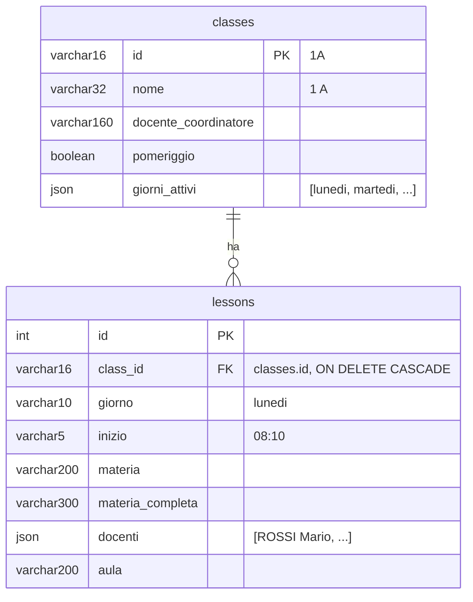
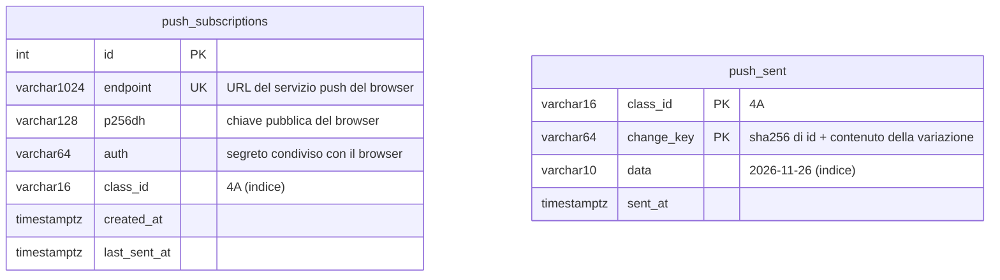

# Schema del database

Il database contiene gli orari delle classi (`SCHEDULE_SOURCE=db`) e le iscrizioni alle notifiche push. Voti e agenda
arrivano sempre da ClasseViva.

## Orari

Due tabelle, create da `python -m scripts.import_schedules`.

- `UNIQUE (class_id, giorno, inizio)`: una classe non può avere due lezioni nello stesso slot.
- Ora di fine e numero d'ora non sono salvati: si calcolano dalla griglia (inizio 08:10, ore da 50 minuti, pause 10:40-10:55 e 16:10-16:20) in `app/schedules.py`. Le lezioni salvate con gli inizi della griglia vecchia ("10:40", "16:10") valgono come 4ª e 10ª ora.
- Cancellare una classe cancella le sue lezioni.
- Reimportare una classe sostituisce tutte le sue lezioni; una classe presente solo nell'indice aggiorna i dati della classe e tiene le lezioni esistenti.

## Notifiche push

Due tabelle, create all'avvio dell'API quando le notifiche sono attive (`VAPID_*` e `DATABASE_URL` impostati).

- Un'iscrizione è un **dispositivo**, non un utente: nessun username, la classe è l'unico legame. `POST /push/subscribe`
  con lo stesso `endpoint` aggiorna la riga (es. cambio di classe) invece di crearne un'altra.
- `endpoint` accetta solo `https` verso i servizi push noti (FCM, Mozilla, WNS, Apple): il server ci fa una POST,
  quindi un indirizzo libero permetterebbe di fargli chiamare servizi interni.
- `push_sent` ricorda le variazioni già notificate a una classe (anche dopo un riavvio). Se il testo di una variazione
  cambia, cambia `change_key` e la si notifica di nuovo. Le righe dei giorni passati si cancellano a ogni giro.
- Le iscrizioni a cui il servizio push risponde 404/410 (scadute o revocate) vengono cancellate.
- Le due tabelle non hanno chiavi esterne verso `classes`: le notifiche funzionano anche con gli orari da JSON.
